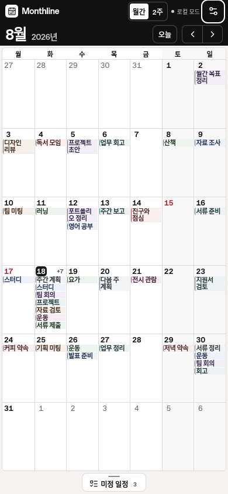
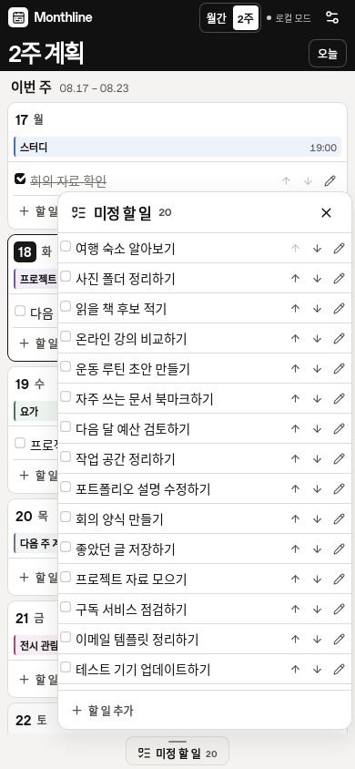
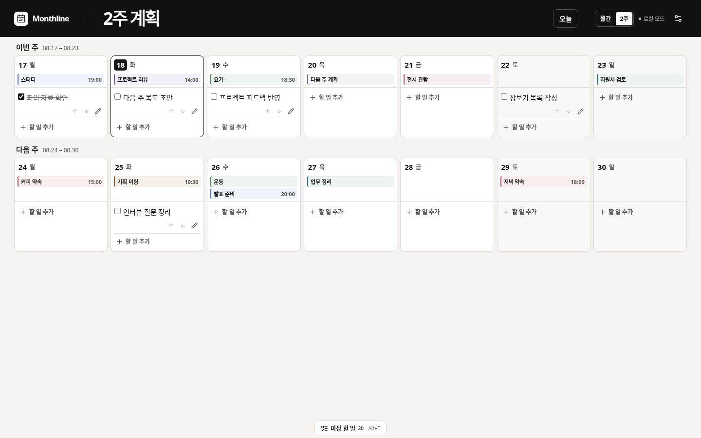

# Monthline

I built Monthline for myself to see the whole month at a glance and plan tasks for this week and next. If that sounds useful to you, feel free to use it too.

Monthline은 월간 캘린더와 2주 할 일 계획을 한곳에서 관리하는 개인용 웹앱입니다. 휴대폰에서는 한 화면에 한 달 전체를 볼 수 있고, 컴퓨터에서는 드래그와 키보드로 일정과 할 일을 빠르게 정리할 수 있습니다. 브라우저에서 바로 열거나 홈 화면에 설치할 수 있습니다.

[기능 살펴보기](#주요-기능) · [로컬에서 시작하기](#로컬에서-시작하기) · [키보드 단축키](#키보드-단축키) · [GitHub Pages 배포](#github-pages-배포)

| 모바일 월간 캘린더 | 모바일 미정 할 일 |
| --- | --- |
|  |  |

## 주요 기능

### 월간 캘린더

- **한 화면에 한 달**. 4~6주에 맞춰 그리드 높이가 조정되고 화면에 여유가 있으면 긴 제목을 두 줄까지 표시합니다. 일정이 많은 날은 `+N`을 눌러 전체 목록을 엽니다. 인접 월 날짜에도 일정을 추가할 수 있습니다.
- **빠른 입력**. 날짜를 누르고 제목을 입력한 뒤 Enter를 누르면 저장합니다. 카테고리와 24시간제 시작·종료 시간을 지정할 수도 있습니다.
- **여러 날에 걸친 일정**. 앱에서 날짜를 길게 누르거나 웹에서 날짜 칸을 누른 채 끌어서 기간을 지정합니다. 일정은 날짜 칸을 가로지르는 하나의 막대로 표시됩니다. 종료 날짜가 다음 날이면 `23:00 → 09:00`처럼 야간 일정도 저장할 수 있습니다.
- **날짜와 카테고리를 바로 수정**. 일정을 원하는 날짜에 끌어 놓고, 아직 날짜가 정해지지 않았다면 하단의 미정 일정 목록에 둡니다. 우클릭 메뉴에서 카테고리를 바꾸거나 삭제할 수 있습니다.
- **주말과 대한민국 공휴일**. 토·일요일 칸은 옅은 배경으로 구분하고, 공휴일의 날짜 숫자는 빨갛게 표시합니다. 정기 공휴일과 대체공휴일은 오프라인에서도 확인할 수 있습니다. 임시공휴일과 별도 지정 선거일은 발표 후 앱 업데이트로 반영합니다. [관공서 공휴일 규정](https://www.law.go.kr/LSW/lsInfoP.do?ancYnChk=0&lsId=002404)

### 2주 계획

- **이번 주와 다음 주**. 날짜별로 월간 일정을 위에, 그날의 할 일을 아래에 표시합니다. 같은 주에서는 가장 높은 일정 영역에 맞춰 할 일 목록 시작선을 정렬합니다.
- **텍스트만 입력하는 할 일**. **할 일 추가**를 누른 뒤 텍스트와 Enter로 연달아 등록합니다. 완료한 할 일에는 취소선이 생깁니다. 위·아래 버튼으로 순서를 바꾸거나, 항목을 다른 날짜로 드래그해 옮길 수 있습니다.
- **넓어진 미정 할 일 목록**. 날짜를 정하기 전에 할 일을 모아 두고, 계획할 때 원하는 날에 끌어 놓습니다. 항목이 많으면 패널이 화면 높이의 최대 70%까지 열리고, 아래쪽에 새 할 일 추가 버튼이 표시됩니다. 2주 계획의 할 일은 월간 일정과 별도로 저장됩니다.

- **주간 정기일정**. 제목과 반복 요일을 저장하면 이번 주와 다음 주의 해당 요일에 표시합니다. 날짜별 할 일은 제목을, 미정 할 일 목록에서는 이동 손잡이를 끌어 순서를 바꿀 수 있습니다.



### 설정과 데이터

- 시스템·라이트·다크·아이보리·자주·차콜 테마, 월요일·일요일 시작, 월간 일정·할 일 글자 크기를 선택할 수 있습니다. 카테고리 이름·색상·순서와 기본 카테고리도 바꿀 수 있습니다.
- 연결을 끊은 상태에서도 이전에 불러온 앱에서 편집할 수 있습니다. 변경 사항은 IndexedDB에 기록되고, Supabase를 사용하면 연결이 돌아오거나 앱을 다시 열었을 때 대기 중인 변경을 동기화합니다.
- 로컬 모드는 가입이나 API 키 없이 바로 사용할 수 있습니다. 데이터를 다른 브라우저로 옮기거나 보관하려면 **설정 → 데이터**에서 JSON 백업을 내보냅니다. 가져오기는 확인을 받은 뒤 현재 데이터를 백업 내용으로 교체합니다.

## 키보드 단축키

| 단축키 | 동작 |
| --- | --- |
| `Ctrl+Tab` | 월간과 2주 계획 전환. `Ctrl+Shift+Space`로도 전환할 수 있습니다. |
| `Alt+E` | 현재 보기의 미정 목록 열기·닫기. 설정에서 변경할 수 있습니다. |
| `←` / `→` | 월간 캘린더에서 이전 달·다음 달로 이동. |
| `Shift+F10` | 초점을 둔 일정 또는 할 일의 메뉴 열기. |
| `↑` / `↓`, `Enter` | 우클릭 메뉴 안에서 항목 이동·선택. |
| `Esc` | 열린 메뉴나 패널 닫기, 이동 취소. |

일반 브라우저 탭에서 `Ctrl+Tab`이 브라우저 탭 전환에 사용되면 `Ctrl+Shift+Space`를 사용합니다. 모바일에서는 하단 손잡이를 위로 끌어 미정 목록을 열 수 있습니다.

## 로컬에서 시작하기

Node.js 24와 npm을 사용합니다.

```sh
npm ci
npm run dev
```

Vite가 표시하는 로컬 주소로 접속합니다. 두 Supabase 환경변수가 모두 비어 있으면 상단에 **로컬 모드**가 표시됩니다. 첫 실행 시 현재 월에 예시 일정이 표시됩니다. **설정 → 데이터 → 예시 일정과 할 일 지우기**로 예시 항목을 삭제할 수 있습니다. 직접 추가한 항목은 유지됩니다.

```sh
npm run build
npm run preview
```

서비스 워커와 설치 메타데이터는 프로덕션 빌드에서 확인할 수 있습니다. 아이폰에서는 HTTPS 주소를 Safari에서 열고 공유 메뉴의 **홈 화면에 추가**를 선택합니다. 첫 온라인 로드 후 앱 셸을 캐시합니다.

## 사용 팁

- 휴대폰에서 월간 화면을 좌우로 밀면 이전 달이나 다음 달로 이동합니다. 키보드로 기간 일정을 추가하려면 날짜 입력창에서 **이 날짜 일정 → 기간 일정**을 선택합니다.
- 날짜가 정해진 항목을 하단의 **미정 목록에 놓기** 영역으로 끌면 날짜를 해제합니다. 키보드로는 미정 일정의 이동 핸들이나 미정 할 일 제목을 Enter로 선택한 뒤 날짜를 고릅니다.
- 할 일을 다른 날짜로 옮기면 해당 날짜의 목록 끝에 추가됩니다. 같은 날에 있는 다른 할 일 앞에 놓으려면 원래 항목을 먼저 선택한 뒤 목표 항목을 선택합니다.

## 기술 구성

- **프론트엔드**는 React, TypeScript, Vite와 CSS Modules를 사용합니다. 마우스·터치 드래그는 dnd-kit으로 처리합니다.
- **저장과 동기화**는 IndexedDB의 로컬 저장소와 선택형 Supabase PostgreSQL·Auth·Realtime을 사용합니다. 서비스 워커가 앱을 캐시하고 GitHub Actions가 검증과 Pages 배포를 담당합니다.

## Supabase 연결

1. 본인의 Supabase 프로젝트에서 [마이그레이션 SQL](supabase/migrations/20261122000000_calendar.sql)을 SQL Editor에서 실행합니다. CLI로 관리한다면 같은 파일을 프로젝트의 마이그레이션 절차로 적용합니다. SQL에는 테이블, 사용자별 RLS, 동기화 RPC, Realtime publication 등록이 포함됩니다.
2. **Authentication → Providers → Email**에서 이메일/비밀번호 로그인을 허용합니다. 새 사용자의 공개 가입 옵션은 비활성화하고 **Authentication → Users**에서 본인의 사용자 한 명을 직접 생성합니다. 이메일 인증이 켜져 있다면 해당 사용자를 확인 완료 상태로 생성하거나 인증을 완료합니다.
3. **Project Settings → API Keys**에서 프로젝트 URL과 브라우저용 **Publishable key**를 확인합니다. `service_role` 또는 Secret key를 프론트엔드와 GitHub 저장소에 넣지 않습니다.
4. 로컬에서 `.env.example`을 `.env.local`로 복사하고 다음 값을 설정한 뒤 Vite를 재시작합니다.

```dotenv
VITE_SUPABASE_URL=https://YOUR_PROJECT_REF.supabase.co
VITE_SUPABASE_PUBLISHABLE_KEY=sb_publishable_YOUR_KEY
```

5. 생성한 이메일과 비밀번호로 로그인합니다. 처음 접속할 때 빈 캘린더와 기본 카테고리 9개가 생성됩니다. 로컬 모드 캐시는 별도이므로 데이터를 옮기려면 먼저 로컬에서 JSON을 내보내고 Supabase 로그인 후 가져옵니다. 예시를 옮기고 싶지 않다면 내보내기 전에 설정에서 예시를 지웁니다.
6. 두 기기에서 같은 계정으로 접속해 일정 이동 또는 테마 변경이 반영되는지 확인합니다. 이어서 한 기기에서 네트워크를 끊고 일정을 수정한 뒤 재접속해 동기화 상태를 확인합니다.

### 저장과 충돌 처리

React UI는 환경과 관계없이 같은 Repository를 사용합니다. IndexedDB는 로컬 모드와 Supabase 프로젝트·사용자별로 캐시를 분리합니다. 로컬 편집과 전송 대기열은 같은 IndexedDB 트랜잭션에 기록되므로 새로고침 후에도 전송할 수 있습니다. 상단 상태 표시에 전송 대기 건수가 나타나며, 연결이 돌아오거나 앱으로 복귀하면 대기 중인 변경을 자동으로 전송합니다. 원격 쓰기는 배치 단위로 처리되며 같은 UUID 기반 작업을 재전송해도 행을 중복 생성하지 않습니다.

같은 레코드의 동시 편집은 변경 시각과 작업 UUID를 기준으로 최신 행을 선택합니다. 삭제도 동기화 기록으로 보존하므로 오래된 요청이 지운 항목을 되살리지 않습니다. 서로 다른 필드의 동시 수정은 합쳐지지 않으며 기기 시계가 크게 다르면 최신 변경 판정에 영향을 줄 수 있습니다. Realtime 알림, 온라인 이벤트, 앱 복귀, 활성 상태의 주기적 재시도로 동기화를 갱신합니다. 로그아웃 시 UI는 다시 인증을 요구하며, 해당 사용자의 로컬 캐시는 브라우저에 남습니다.

## GitHub Pages 배포

1. GitHub 저장소를 만들고 프로젝트를 커밋해 `main`으로 푸시합니다.
2. 저장소 **Settings → Pages → Build and deployment → Source**를 **GitHub Actions**로 지정합니다.
3. **Settings → Secrets and variables → Actions**의 Variables에 `VITE_SUPABASE_URL`과 `VITE_SUPABASE_PUBLISHABLE_KEY`를 등록합니다. 같은 이름의 Secrets도 지원합니다. Vite가 값을 빌드 결과에 포함하므로 Publishable key만 사용합니다.
4. **Actions → Verify and deploy to GitHub Pages → Run workflow**를 실행하거나 `main`을 갱신합니다. 검증을 통과하면 `github-pages` 환경으로 배포됩니다. 테스트는 배포용 변수와 무관하게 로컬 모드로 실행합니다.
5. GitHub가 표시하는 Pages URL을 Safari에서 열어 로그인과 설치를 확인합니다. Vite의 상대 경로 및 서비스 워커 범위는 `/저장소이름/` 하위 경로를 지원합니다.

GitHub 계정이나 저장소를 바꿔 Pages 주소가 달라지면 브라우저 로컬 데이터는 이전 주소에 남습니다. 로컬 모드를 사용 중이었다면 기존 주소에서 JSON 백업을 내보내 새 주소로 가져옵니다. Supabase로 동기화한 데이터는 새 배포에 같은 프로젝트를 연결하고 이전과 같은 계정으로 로그인하면 불러옵니다.

## 검증

```sh
npm run typecheck
npm run lint
npm test
npx playwright install --with-deps chromium webkit
npm run test:e2e
```

- Vitest와 React Testing Library로 달력 계산, 일정 폼, 화면 설정, IndexedDB, 오프라인 재시도와 충돌, 백업을 검증합니다.
- PGlite의 PostgreSQL에서 마이그레이션을 적용하고 비인증 접근 거부, 사용자 간 격리, 멱등성, 날짜 제약을 검증합니다. Supabase Auth와 Realtime의 실제 호스팅 연결 검증에는 사용자의 프로젝트가 필요합니다.
- Playwright는 하위 경로에서 프로덕션 빌드를 실행합니다. WebKit 390×844 및 375×667, Chromium 1440×900을 사용하며 Chromium 터치 입력도 검증합니다. 브라우저에서 모의 Supabase API를 사용해 로그인 유지, 오프라인 편집, 재전송 및 로그아웃을 검증합니다. 시각 검증 PNG는 `test-results/**/visual/`에 저장됩니다. GitHub Actions에서는 `visual-verification` 아티팩트로 받을 수 있습니다.
- Playwright WebKit은 브라우저 엔진과 레이아웃을 검증합니다. iOS 홈 화면 설치, 실제 Safe Area, Safari 소프트 키보드, iOS의 길게 누르기 동작은 실제 기기에서 확인해야 합니다. 인증 캐시가 없는 기기의 첫 로그인과 초기 데이터 로드에는 연결이 필요합니다.
